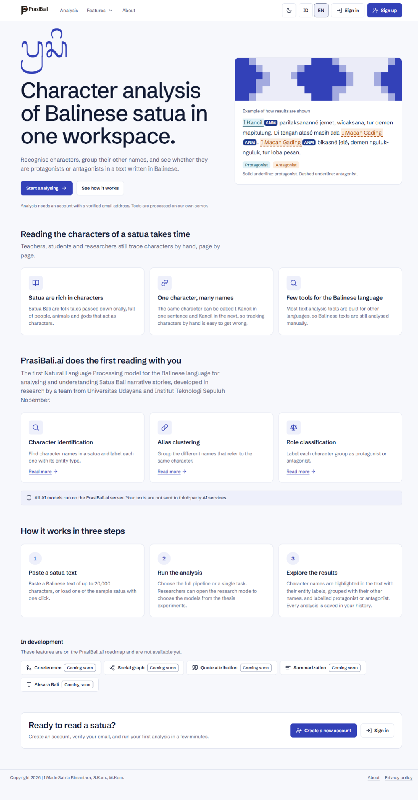
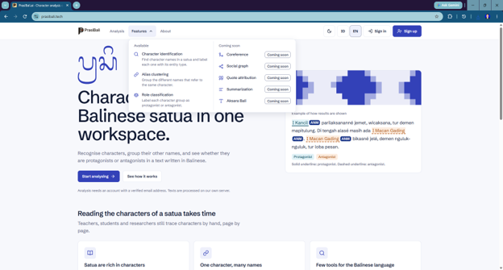
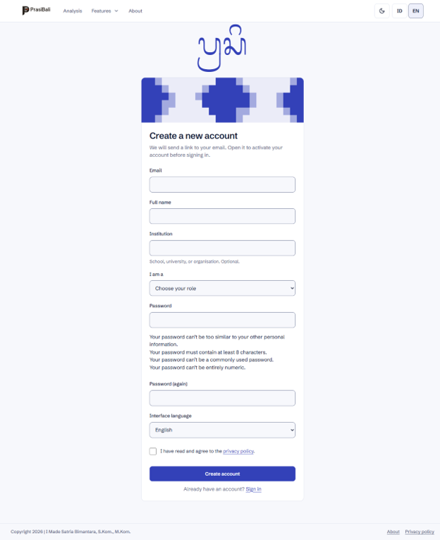
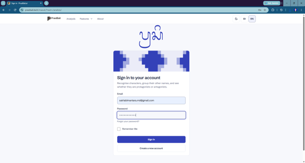
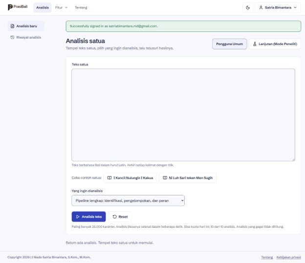
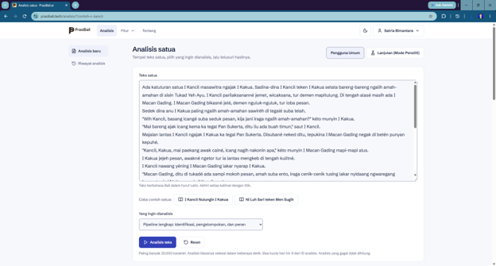
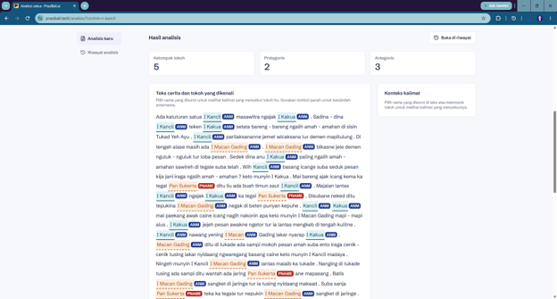
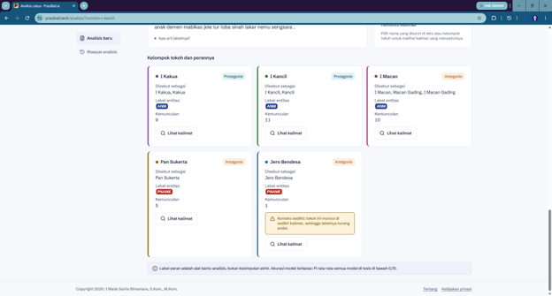
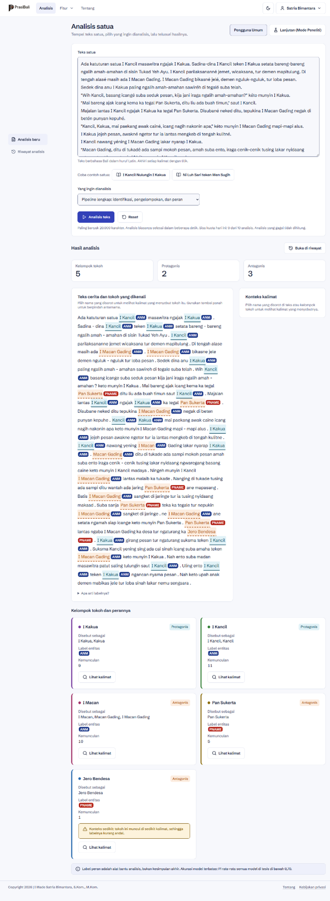
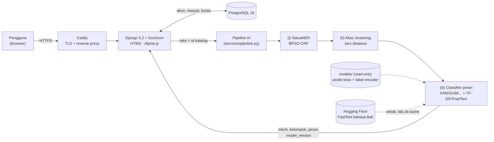

<div align="center">

<picture>
  <source media="(prefers-color-scheme: dark)" srcset="assets/PrasiBali-Logo/svg/prasibali-logo-latar-gelap.svg">
  
</picture>

### Analisis tokoh satua Bali berbasis Natural Language Processing

Kenali tokoh, kelompokkan nama-nama lainnya, dan lihat apakah mereka protagonis atau antagonis, langsung dari teks satua berbahasa Bali.

[](https://prasibali.tech)
[](.python-version)
[](requirements.txt)
[](https://pypi.org/project/balinese-nlp/2.4.2/)
[](LICENSE)

[**Website**](https://prasibali.tech) · [Panduan menjalankan](#instalasi-dan-menjalankan) · [AI & Technology Disclosure](AI_DISCLOSURE.md) · [Dataset](https://doi.org/10.17632/h2tf5ymcp9.3)

<sub>AI Web Innovation Challenge · Bali Digital Festival 2026 · Tahap 1 · rilis <code>v1.0-submission</code></sub>

</div>

---

## Daftar isi

[Deskripsi](#deskripsi) · [Masalah dan pengguna](#masalah-dan-pengguna-sasaran) · [Fitur utama](#fitur-utama) · [Tur produk](#tur-produk) · [Teknologi](#teknologi) · [Implementasi AI](#implementasi-ai) · [Arsitektur](#arsitektur-dan-alur-data) · [Instalasi](#instalasi-dan-menjalankan) · [Deployment](#url-deployment) · [Akun demo](#akun-demo) · [Keterbatasan](#keterbatasan) · [Kredit](#sumber-pihak-ketiga-dan-kredit) · [Referensi](#referensi) · [Tim](#tim)

## Deskripsi

**PrasiBali** adalah aplikasi web untuk membaca dan menganalisis tokoh dalam *satua* (cerita rakyat Bali). Pengguna menempelkan teks satua berbahasa Bali, lalu tiga model AI menjalankan analisis berurutan:

1. **Identifikasi tokoh**: menemukan nama tokoh dan memberi label entitasnya (`PNAME`, `ANM`, `GODS`, `ADJ`, `OBJ`).
2. **Alias clustering**: mengelompokkan nama-nama berbeda yang merujuk ke tokoh yang sama (misalnya *I Kancil* dan *Kancil*).
3. **Klasifikasi peran**: memberi label **protagonis** atau **antagonis** pada setiap kelompok tokoh.

Model-modelnya berasal dari penelitian tesis magister pengembang, *Identifikasi Tokoh dan Penokohan pada Teks Cerita Berbahasa Bali Menggunakan Pendekatan Berbasis Aturan dan Supervised Machine Learning* (Institut Teknologi Sepuluh Nopember, 2024), dan dilatih pada dataset 120 satua Bali beranotasi yang dipublikasikan di *Data in Brief* (Elsevier, 2024). PrasiBali menjadikan hasil riset itu alat yang bisa dipakai siapa saja lewat browser. Semua model berjalan di server sendiri, dan teks pengguna tidak dikirim ke layanan AI pihak ketiga.

Nama *prasi* diambil dari seni lukis di atas daun lontar Bali, tempat teks dan gambar berada pada satu lembar.

## Masalah dan pengguna sasaran

**Masalah.** Satua adalah media pendidikan karakter yang diwariskan turun-temurun, dan isinya kaya tokoh: manusia, binatang, dewa, hingga benda yang dipersonifikasikan. Menelusuri tokoh dan penokohannya masih dikerjakan manual, halaman demi halaman, dengan tiga kesulitan:

- **Satu tokoh, banyak sebutan.** Tokoh yang sama bisa disebut *I Kancil* di satu kalimat dan *Kancil* di kalimat berikutnya, sehingga mudah salah hitung.
- **Tokoh bukan hanya nama orang.** NER umum hanya mengenali entitas `PERSON`, padahal tokoh satua sering berupa binatang (*I Kakua*), dewa (*Bhatara Indra*), atau sebutan tanpa nama (*memene*, *I dagang nasi*).
- **Bahasa Bali minim alat.** Bahasa Bali tergolong *low-resource language*. Hampir semua alat analisis teks dibangun untuk bahasa lain, dan belum ada model mapan untuk identifikasi tokoh dan penokohan satua.

**Pengguna sasaran.**

| Pengguna | Kebutuhan |
|---|---|
| Guru dan siswa Bahasa Bali (SD hingga SMA/SMK) | Bahan ajar unsur intrinsik satua: siapa tokohnya dan bagaimana perannya, dalam hitungan detik |
| Mahasiswa dan dosen sastra/bahasa Bali | Pembacaan awal yang konsisten sebelum analisis mendalam |
| Peneliti NLP dan digital humanities | Mencoba ulang konfigurasi model dari eksperimen tesis lewat **Mode Peneliti**, lengkap dengan skor referensinya |
| Pegiat literasi dan pelestari budaya Bali | Cara baru memperkenalkan satua ke pembaca muda |

## Fitur utama

Semua fitur berikut **berfungsi end-to-end** di [prasibali.tech](https://prasibali.tech) pada rilis `v1.0-submission`.

| Fitur | Keterangan |
|---|---|
| **Pipeline analisis lengkap** | Identifikasi tokoh → alias clustering → klasifikasi peran dalam satu klik, biasanya selesai dalam 1–2 detik |
| **Mode tugas terpisah** | Pilih pipeline lengkap, identifikasi saja, identifikasi + pengelompokan nama, atau klasifikasi peran |
| **Hasil bertahap dan interaktif** | Teks dengan nama tokoh disorot beserta label entitasnya, kartu kelompok alias dengan warna berbeda per tokoh, label peran per kelompok, dan panel "konteks kalimat" yang menampilkan kalimat tempat tokoh muncul |
| **Disclaimer dan peringatan keandalan** | Setiap hasil peran disertai disclaimer akurasi model; kelompok dengan konteks sangat sedikit diberi peringatan "konteks sedikit" |
| **Mode Peneliti** | Pilih model NER (5), metode alias clustering (5) dan ambangnya, serta classifier peran (24 konfigurasi dari eksperimen tesis), masing-masing dengan F1 referensi dan rujukan tabel tesis |
| **Riwayat analisis** | Daftar, detail (termasuk konfigurasi dan versi model yang dipakai), hapus satu, hapus semua |
| **Coba contoh satua** | Dua teks contoh yang bisa dimuat dengan satu klik |
| **Akun pengguna** | Registrasi dengan verifikasi email, login, logout, reset kata sandi, profil, hapus akun |
| **Dwibahasa** | Antarmuka Bahasa Indonesia (bawaan) dan Inggris, plus tema terang/gelap |
| **Batas pemakaian wajar** | Kuota 10 analisis per pengguna per hari (analisis gagal tidak dihitung) dan batas 20.000 karakter per teks |

**Segera hadir** (tampil di menu sebagai peta jalan, belum berfungsi): Coreference Resolution, Social Graph tokoh, Quote Attribution, Summarization, dan dukungan Aksara Bali.

## Tur produk

Urutan tangkapan layar mengikuti perjalanan pengguna di [prasibali.tech](https://prasibali.tech), dari kunjungan pertama sampai hasil analisis.

**1. Beranda.** Pengunjung melihat masalah yang diselesaikan, tiga fitur inti, alur tiga langkah, dan contoh tampilan hasil.

<p align="center"></p>

**2. Menu fitur.** Tiga fitur yang sudah tersedia dan lima fitur yang masih "Segera hadir".

<p align="center"></p>

**3. Daftar dan masuk.** Analisis membutuhkan akun dengan email terverifikasi. Tautan aktivasi dikirim ke email pendaftar.

<table>
  <tr>
    <td width="50%" align="center"><br><sub>Daftar akun baru</sub></td>
    <td width="50%" align="center"><br><sub>Masuk</sub></td>
  </tr>
</table>

**4. Ruang kerja analisis.** Tempel teks satua atau muat contoh, pilih jenis analisis, lalu klik **Analisis teks**. Sisa kuota harian tampil di bawah tombol. Tombol **Lanjutan (Mode Peneliti)** membuka pilihan model.

<table>
  <tr>
    <td width="50%" align="center"><br><sub>Ruang kerja kosong</sub></td>
    <td width="50%" align="center"><br><sub>Contoh satua dimuat</sub></td>
  </tr>
</table>

**5. Hasil identifikasi tokoh.** Ringkasan jumlah kelompok tokoh, protagonis, dan antagonis; teks cerita dengan setiap nama tokoh disorot beserta label entitasnya. Klik nama untuk melihat kalimat-kalimat yang menyebut tokoh itu.

<p align="center"></p>

**6. Kelompok tokoh dan perannya.** Setiap kartu adalah satu tokoh beserta semua sebutannya (hasil alias clustering), label entitas, jumlah kemunculan, dan label peran. Kelompok dengan konteks sedikit diberi peringatan, dan disclaimer akurasi model tampil di bawah hasil.

<p align="center"></p>

<details>
<summary>Tampilan satu halaman penuh dari input sampai hasil</summary>
<p align="center"></p>
</details>

## Teknologi

| Lapisan | Teknologi |
|---|---|
| Frontend | Django Templates, Tailwind CSS 4 (standalone CLI, tanpa Node), HTMX 2, Alpine.js 3, ikon Lucide (SVG inline) |
| Backend | Python 3.11, Django 5.2 LTS, django-allauth (akun dan verifikasi email), django-environ |
| AI / NLP | `balinese-nlp` 2.4.2, scikit-learn 1.2.1, sklearn-crfsuite, gensim (FastText), pandas, NumPy |
| Database | PostgreSQL 16 (akun, riwayat analisis dengan konfigurasi JSON, kuota harian) |
| Server | Gunicorn (worker sync, `--preload`), Caddy 2 (HTTPS otomatis Let's Encrypt), WhiteNoise |
| Infrastruktur | Docker Compose, VPS Hostinger KVM 1 (Ubuntu), SMTP Hostinger Email, backup `pg_dump` harian |
| Kualitas | pytest + pytest-django (244 test), ruff, GitHub Actions (lint + test dengan PostgreSQL) |

Daftar lengkap beserta versi dan lisensinya ada di [AI_DISCLOSURE.md](AI_DISCLOSURE.md).

## Implementasi AI

AI adalah inti produk. Ketiga tahap analisis adalah model machine learning yang dijalankan di server PrasiBali untuk setiap permintaan analisis.

| Tahap | Input → Output | Model bawaan | Metode | Skor referensi (tesis) |
|---|---|---|---|---|
| **(i) Identifikasi tokoh** | kalimat satua → nama tokoh + label `PNAME`/`ANM`/`GODS`/`ADJ`/`OBJ` | **SatuaNER** (`balinese-nlp`) | Conditional Random Fields dengan seleksi fitur Binary Particle Swarm Optimization (BPSO-CRF) | F1 CV 0,954 · F1 uji 0,8353 (Tabel 4.18–4.19) |
| **(ii) Alias clustering** | daftar nama tokoh → kelompok tokoh | `AliasClusteringRuleBased` (`balinese-nlp`) | Pengelompokan berbasis aturan dengan *pairwise string similarity* Jaro distance, ambang 0,85 | F1 0,7172 (Tabel 4.36–4.37) |
| **(iii) Klasifikasi peran** | kalimat konteks tiap kelompok → Protagonis/Antagonis | **K-Nearest Neighbor + TF-IDF (TF4), varian M2** | Supervised ML pada fitur word vector, pickle hasil eksperimen tesis | F1 CV 0,6666 · F1 uji 0,6451 (Tabel 4.57, 4.60) |

Label entitas tokoh (Tabel 3.2 tesis): `PNAME` nama diri orang (*Ni Luh Sari*), `ANM` binatang atau benda yang dipersonifikasikan (*I Kancil*), `GODS` entitas ketuhanan (*Bhatara Indra*), `ADJ` frasa sifat yang dipakai sebagai nama (*I Belog*), `OBJ` sebutan tanpa nama diri (*memene*, *I dagang nasi*).

**Mengapa AI diperlukan.** Tokoh satua tidak bisa dikenali dengan daftar kata: bentuknya beragam (nama, binatang, dewa, sebutan), penulisannya tidak konsisten, dan peran tokoh hanya bisa disimpulkan dari konteks kalimat. Model sekuensial (CRF) membaca pola kata dan konteks sekitarnya, sedangkan classifier peran belajar dari 120 satua beranotasi penutur asli bahasa Bali.

**Alur di dalam pipeline** ([`src/apps/analysis/services/pipeline.py`](src/apps/analysis/services/pipeline.py)):

1. *Validasi dan praproses*: batas 20.000 karakter, deteksi aksara Bali, pemecahan kalimat dan normalisasi dengan `TextPreprocessor` dari `balinese-nlp`.
2. *Identifikasi*: SatuaNER memberi tag BIO per token; nama dan posisinya disusun ulang untuk penyorotan.
3. *Alias clustering*: nama unik diurutkan (agar hasil deterministik), lalu dikelompokkan dengan metode kemiripan string yang dipilih.
4. *Klasifikasi peran*: kalimat yang menyebut setiap kelompok dikumpulkan (`RuleBasedSentenceGrouping`), diubah menjadi fitur (TF-IDF atau rata-rata vektor FastText 300 dimensi), dicek jumlah fiturnya terhadap `n_features_in_` estimator, lalu diprediksi dan dipetakan ke label lewat label encoder.
5. *Pencatatan*: setiap analisis disimpan di `AnalysisRun` beserta konfigurasi dan `model_version` (versi `balinese-nlp` dan scikit-learn, model NER, metode dan ambang alias, `id` katalog classifier, hash SHA-256 file pickle, serta identitas embedding bila memakai TF5).

**Mode Peneliti.** Katalog statis [`model_catalog.py`](src/apps/analysis/services/model_catalog.py) memuat 72 konfigurasi classifier dari eksperimen tesis (varian M1/M2 × jenis fitur × kode fitur × enam algoritma: KNN, Decision Tree, SVM, Gaussian Naive Bayes, Random Forest, Multilayer Perceptron). Sebanyak 24 konfigurasi word vector (TF4, TF5, TF4+TF5) tersedia; 48 konfigurasi leksikon (TF1–TF3, BaliSentiLex) tampil sebagai "segera hadir". Setiap pilihan menampilkan dua F1 referensi tesis: rata-rata *10-fold cross-validation* dan F1 data uji. Model terbaik menurut tesis, **SVM + TF5 (M2)** dengan F1 CV 0,6811 dan F1 uji 0,6460, ditandai "terbaik menurut tesis"; bawaan mode Pengguna Umum adalah KNN + TF4 (M2), yang pada uji coba beberapa satua memberi hasil peran lebih baik dan tidak memerlukan FastText.

**Keamanan dan keandalan model.**

- Pilihan model dari pengguna hanya berupa `id` katalog yang divalidasi di server. Path file tidak pernah diterima dari input, karena memuat pickle dapat menjalankan kode.
- Model dimuat *lazy* dengan cache terbatas; SatuaNER, classifier bawaan, dan FastText dipanaskan sekali saat container start (`warm_models`), lalu Hugging Face berjalan offline.
- Kegagalan setiap tahap menghasilkan exception khusus dan pesan ramah; aplikasi tetap menyala walau folder model tidak ada.
- Skor ditampilkan apa adanya: untuk SVM berupa `decision_function` (jarak ke hyperplane), bukan probabilitas atau "keyakinan".

## Arsitektur dan alur data



1. Pengguna yang sudah login dan terverifikasi mengirim teks dari ruang kerja (HTMX, tanpa muat ulang halaman).
2. Django memeriksa kuota harian dan memvalidasi konfigurasi terhadap whitelist katalog.
3. Pipeline menjalankan tahap (i) sampai (iii) di proses yang sama; model sudah ada di memori.
4. Hasil dan konfigurasi disimpan sebagai `AnalysisRun` di PostgreSQL, lalu ditampilkan bertahap sebagai partial HTML.

Struktur repositori:

```text
src/
  config/              settings (base, dev, prod, test), urls, gunicorn, logging JSON
  apps/accounts/       akun email, allauth, profil, bahasa, akun demo
  apps/analysis/       ruang kerja, riwayat, kuota, admin
    services/          model_catalog, model_registry, pipeline, features, embeddings, preprocessing
  apps/pages/          beranda, fitur, tentang, privasi, healthz
  templates/  static/  locale/ (id, en)
tests/                 pytest: pipeline, katalog model, auth, kuota, riwayat, halaman, produksi
docker/                Dockerfile multi-stage, Caddyfile, entrypoint, backup
deploy/server/         setup VPS, init .env, deploy via git push
scripts/               cek environment, uji pipeline, bundel model, build Tailwind
docs/                  deploy.md, deploy_hostinger.md
```

## Instalasi dan menjalankan

### Opsi A: langsung di website (tanpa instalasi)

Buka **<https://prasibali.tech>**, lalu **Daftar** (tautan aktivasi dikirim ke email) atau **Masuk** dengan [akun demo juri](#akun-demo). Klik **Analisis**, pilih **Coba contoh satua**, lalu **Analisis teks**.

### Opsi B: Docker di komputer lokal

**Prasyarat:** [Docker Desktop](https://www.docker.com/products/docker-desktop/) (atau Docker Engine + Compose v2), Git, sekitar 8 GB ruang disk, dan RAM minimal 4 GB (8 GB bila mencoba model TF5).

**1. Ambil kode**

```bash
git clone https://github.com/satriabimantara/prasibali.git
cd prasibali
```

**2. Unduh model pretrained** (30 MB). Pickle classifier tidak disimpan di git; bundelnya dilampirkan pada [rilis `v1.0-submission`](https://github.com/satriabimantara/prasibali/releases/tag/v1.0-submission). Unduh `prasibali-models-v1.0.tar.gz` dari halaman rilis, atau lewat terminal:

```bash
# repo publik
curl -L -o prasibali-models-v1.0.tar.gz https://github.com/satriabimantara/prasibali/releases/download/v1.0-submission/prasibali-models-v1.0.tar.gz
# repo privat (akun GitHub yang diberi akses)
gh release download v1.0-submission -R satriabimantara/prasibali -p "prasibali-models-v1.0.tar.gz"
```

Ekstrak ke folder `models/` (perintah `tar` tersedia di Linux, macOS, dan Windows 10/11):

```bash
mkdir models
tar -xzf prasibali-models-v1.0.tar.gz -C models
```

Di Linux/macOS, `cd models && sha256sum -c SHA256SUMS && cd ..` harus mencetak `OK` untuk setiap file. Model NER dan alias clustering sudah ikut di paket `balinese-nlp`, sehingga tidak perlu diunduh terpisah.

**3. Buat file `.env`** di akar repo. Untuk lokal cukup isi berikut (ganti nilai contoh; jangan memakai `.env.example`, karena isinya untuk server produksi):

```dotenv
DJANGO_SECRET_KEY=ganti-dengan-string-acak-panjang
POSTGRES_DB=prasibali
POSTGRES_USER=prasibali
POSTGRES_PASSWORD=ganti-password-lokal
DEMO_USER_EMAIL=juri@contoh.local
DEMO_USER_PASSWORD=ganti-password-demo-lokal
```

**4. Jalankan**

```bash
docker compose up --build
```

Build pertama memakan waktu sekitar 10–20 menit (memasang PyTorch CPU dan dependensi NLP). Aplikasi siap bila log menampilkan `Starting development server at http://0.0.0.0:8000/`.

**5. Buat akun dan analisis.** Di terminal lain, buat akun terverifikasi dari nilai `DEMO_USER_*` di `.env`:

```bash
docker compose exec web python manage.py create_demo_user
```

Buka <http://localhost:8000>, masuk dengan akun tersebut, lalu jalankan analisis. Pendaftaran akun baru juga bisa dicoba: di mode lokal email tidak dikirim, dan tautan aktivasinya tercetak di log (`docker compose logs web`).

**6. Test dan lint (opsional)**

```bash
docker compose exec web pytest       # 244 test; test bertanda "model" memakai folder models/
docker compose exec web ruff check .
```

> **Catatan.** Model bawaan (KNN + TF4) tidak memerlukan FastText. Saat konfigurasi TF5 pertama kali dipilih di Mode Peneliti, embedding FastText 300 dimensi (sekitar 2,4 GB) diunduh sekali dari Hugging Face ke volume `hf_cache`, dan prosesnya memakai sekitar 2,5 GB RAM. Tanpa folder `models/`, aplikasi tetap berjalan: identifikasi tokoh dan alias clustering berfungsi, sedangkan tahap klasifikasi peran menampilkan pesan bahwa model tidak tersedia.

Panduan produksi: [docs/deploy.md](docs/deploy.md) (VPS umum) dan [docs/deploy_hostinger.md](docs/deploy_hostinger.md) (Hostinger KVM 1, rilis lewat `git push`).

## URL deployment

| | |
|---|---|
| Aplikasi | **<https://prasibali.tech>** (`www.prasibali.tech` dialihkan ke sana) |
| Health check | <https://prasibali.tech/healthz> → `{"status": "ok", "database": "ok"}` |
| Versi yang dinilai | tag [`v1.0-submission`](https://github.com/satriabimantara/prasibali/releases/tag/v1.0-submission) |
| Hosting | VPS Hostinger KVM 1 (1 vCPU, 4 GB RAM), Docker Compose, HTTPS Let's Encrypt |

## Akun demo

Juri dapat mendaftar akun baru di [prasibali.tech/daftar](https://prasibali.tech/daftar/) atau memakai akun demo yang sudah terverifikasi:

| | |
|---|---|
| Email | `demojuri1@prasibali.tech` |
| Kata sandi | dikirim melalui formulir resmi panitia (tidak disimpan di repositori, sesuai ketentuan lomba) |

Kuota akun demo sama dengan pengguna lain: 10 analisis per hari.

## Keterbatasan

- **Akurasi klasifikasi peran terbatas.** F1 rata-rata semua classifier di tesis masih di bawah 0,70 (terbaik 0,6811). Kalimat konteks sebuah kelompok tokoh sering juga memuat deskripsi tokoh lain, dan hasil cenderung condong ke label antagonis. Label peran adalah alat bantu analisis, bukan kesimpulan akhir; karena itu setiap hasil disertai disclaimer.
- **Alias clustering berbasis kemiripan string.** Sebutan dengan akhiran (*Kakua* dan *Kakuane*) bisa terpisah, sebutan umum (*Luh*, *pekak*) bisa muncul sebagai tokoh, dan frasa yang memuat nama tokoh lain bisa tergabung.
- **Tanpa coreference resolution.** Kata ganti (*ia*, *ida*) belum ditautkan ke tokohnya; fitur ini ada di peta jalan.
- **Teks ditampilkan setelah praproses.** Spasi di sekitar tanda baca berubah (misalnya `amah - amahan`) karena penyorotan memakai teks hasil praproses.
- **Hanya huruf Latin.** Teks beraksara Bali ditolak dengan pesan yang jelas. Teks dengan kurang dari 11 kalimat tetap dianalisis, tetapi diberi peringatan.
- **Model leksikon belum tersedia.** 48 konfigurasi berbasis BaliSentiLex (TF1–TF3) belum bisa dimuat karena pickle-nya merujuk modul lama, sehingga tampil "segera hadir" di Mode Peneliti.
- **Domain data terbatas.** Model dilatih pada 120 satua; performa pada teks Bali modern atau ragam lain belum diuji.
- **Kapasitas server.** VPS 1 vCPU melayani 2 worker; satua terpanjang (sekitar 17.000 karakter) selesai 1–2 detik untuk satu pengguna dan hingga sekitar 5 detik saat tiga pengguna bersamaan.
- **REST API belum tersedia.** Direncanakan untuk versi berikutnya.

## Sumber pihak ketiga dan kredit

Ringkasan berikut dirinci, termasuk versi dan lisensi setiap komponen, di **[AI_DISCLOSURE.md](AI_DISCLOSURE.md)**.

- **Komponen pra-kompetisi milik pengembang:** paket [`balinese-nlp`](https://pypi.org/project/balinese-nlp/2.4.2/) (SatuaNER, alias clustering, praproses, ekstraktor fitur), pickle classifier hasil eksperimen tesis, [embedding FastText bahasa Bali](https://huggingface.co/satriabimantara/balinese_pretrained_wordembedding) di Hugging Face, [dataset satua Bali](https://doi.org/10.17632/h2tf5ymcp9.3) di Mendeley Data (CC BY 4.0), dan repositori riset [BaliStoryAnalyzer](https://github.com/satriabimantara/balinese_storyanalyzer). Aplikasi web PrasiBali sendiri dibangun untuk kompetisi ini.
- **Library open-source:** Django, django-allauth, scikit-learn, gensim, sklearn-crfsuite, PyTorch, Transformers, Tailwind CSS, HTMX, Alpine.js, dan lainnya, masing-masing sesuai lisensinya.
- **Aset:** font Schibsted Grotesk dan Noto Serif Balinese (Google Fonts, SIL OFL 1.1), ikon [Lucide](https://lucide.dev) (ISC). Logo dan pola ikat dibuat khusus untuk PrasiBali.
- **AI coding assistant:** Claude Code dan Claude.ai (Anthropic) membantu penulisan kode, test, dan dokumentasi. Semua kode ditinjau, diuji, dan menjadi tanggung jawab tim.

## Referensi

Publikasi dan artefak riset yang mendasari PrasiBali:

1. Bimantara, I. M. S. (2024). *Identifikasi Tokoh dan Penokohan pada Teks Cerita Berbahasa Bali Menggunakan Pendekatan Berbasis Aturan dan Supervised Machine Learning* [Tesis magister]. Program Studi S2 Teknik Informatika, Institut Teknologi Sepuluh Nopember, Surabaya.
2. Bimantara, I. M. S., Sanjaya ER, N. A., & Purwitasari, D. (2023). Character Entity Recognition Using Hybrid Binary-Particle Swarm Optimization and Conditional Random Field on Balinese Folklore Text. *Information Integration and Web Intelligence (iiWAS 2023)*, Lecture Notes in Computer Science vol. 14416, 128–133. Springer. <https://doi.org/10.1007/978-3-031-48316-5_15>
3. Bimantara, I. M. S., Purwitasari, D., Sanjaya ER, N. A., & Natha, P. G. S. (2024). Balinese Story Texts Dataset for Narrative Text Analyses. *Data in Brief*, 56, 110781. Elsevier. <https://doi.org/10.1016/j.dib.2024.110781>
4. Bimantara, I. M. S., Purwitasari, D., & Sanjaya ER, N. A. (2024). *Balinese Story Texts Dataset – Characters, Aliases, and their Classification* (Versi 3) [Dataset]. Mendeley Data. <https://doi.org/10.17632/h2tf5ymcp9.3>
5. Bimantara, I. M. S. (2025). *balinese-nlp* (Versi 2.4.2) [Paket Python]. PyPI. <https://pypi.org/project/balinese-nlp/2.4.2/>
6. Bimantara, I. M. S. *balinese_pretrained_wordembedding* [Model word embedding bahasa Bali]. Hugging Face. <https://huggingface.co/satriabimantara/balinese_pretrained_wordembedding>
7. Suwija, I. N., Darmada, I. M., & Mulyawan, I. N. R. (2019). *Kumpulan Satua (Dongeng Rakyat Bali)*. Pelawa Sari. (Sumber 120 teks satua pada dataset.)
8. Sutton, C., & McCallum, A. (2012). An Introduction to Conditional Random Fields. *Foundations and Trends in Machine Learning*, 4(4), 267–373.
9. Nguyen, B. H., Xue, B., Andreae, P., & Zhang, M. (2021). A New Binary Particle Swarm Optimization Approach: Momentum and Dynamic Balance between Exploration and Exploitation. *IEEE Transactions on Cybernetics*, 51(2), 589–603. <https://doi.org/10.1109/TCYB.2019.2944141>
10. Jahan, L., Mittal, R., Yarlott, W. V. H., & Finlayson, M. A. (2020). A Straightforward Approach to Narratologically Grounded Character Identification. *Proceedings of COLING 2020*, 6089–6100.
11. Vala, H., Jurgens, D., Piper, A., & Ruths, D. (2015). Mr. Bennet, his coachman, and the Archbishop walk into a bar but only one of them gets recognized: On The Difficulty of Detecting Characters in Literary Texts. *Proceedings of EMNLP 2015*, 769–774. <https://doi.org/10.18653/v1/D15-1088>
12. Kurniadi, K., & Sanjaya ER, N. A. (2021). Person Named Entity Recognition in Balinese. *Jurnal Elektronik Ilmu Komputer Udayana*, 10(1), 99–104. <https://doi.org/10.24843/JLK.2021.v10.i01.p13>

<details>
<summary>BibTeX untuk mensitasi PrasiBali</summary>

```bibtex
@inproceedings{bimantara2023character,
  title     = {Character Entity Recognition Using Hybrid Binary-Particle Swarm Optimization and Conditional Random Field on Balinese Folklore Text},
  author    = {Bimantara, I Made Satria and Sanjaya ER, Ngurah Agus and Purwitasari, Diana},
  booktitle = {Information Integration and Web Intelligence (iiWAS 2023)},
  series    = {Lecture Notes in Computer Science},
  volume    = {14416},
  pages     = {128--133},
  publisher = {Springer},
  year      = {2023},
  doi       = {10.1007/978-3-031-48316-5_15}
}

@article{bimantara2024dataset,
  title   = {Balinese Story Texts Dataset for Narrative Text Analyses},
  author  = {Bimantara, I Made Satria and Purwitasari, Diana and Sanjaya ER, Ngurah Agus and Natha, P. G. S.},
  journal = {Data in Brief},
  volume  = {56},
  pages   = {110781},
  year    = {2024},
  doi     = {10.1016/j.dib.2024.110781}
}
```

</details>

## Tim

| Nama | Peran | Afiliasi |
|---|---|---|
| **I Made Satria Bimantara, S.Kom., M.Kom.** | Ketua tim; peneliti dan pengembang PrasiBali | Program Studi Informatika, FMIPA, Universitas Udayana |
| Dr. Ir. Ngurah Agus Sanjaya ER, S.Kom., M.Kom. | Anggota; ko-pembimbing tesis dan rekan penulis publikasi | Program Studi Informatika, FMIPA, Universitas Udayana |
| Prof. Dr. Ir. Diana Purwitasari, S.Kom., M.Sc. | Anggota; pembimbing tesis dan rekan penulis publikasi | Departemen Teknik Informatika, Institut Teknologi Sepuluh Nopember |

## Lisensi

Kode sumber PrasiBali dirilis di bawah [BSD 3-Clause License](LICENSE). © 2026 I Made Satria Bimantara. Dataset dan model mengikuti lisensinya masing-masing (lihat [AI_DISCLOSURE.md](AI_DISCLOSURE.md)).
